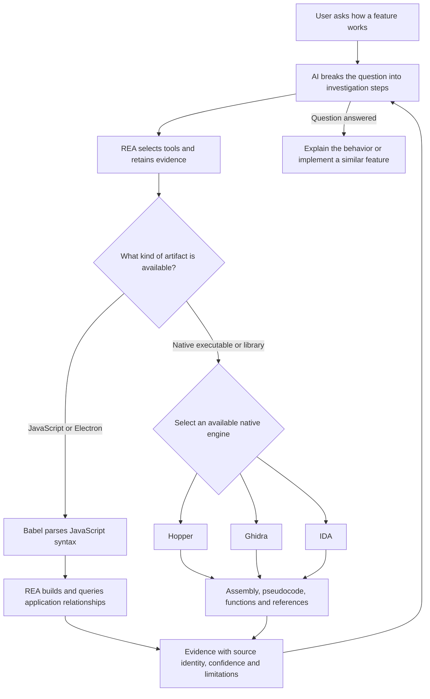

# REA architecture and tool responsibilities

Learning label: **逆向任何软件（REA）** — Reverse Engineer Anything. Keep this label with the research archive for future study.

REA connects an AI agent to software-analysis engines and returns evidence that the agent can use to investigate a feature. Its practical value is the investigation workflow: choosing a suitable engine, following a focused question, retaining source identity, and distinguishing observations from inferences.

This note records a source review of commit `4d95f2b2e7a6fdc1ba9dfcbd90578f6bbc5e5e1e`. The review did not execute a reverse-engineering investigation against a target application. Tool capabilities below describe their documented roles, not a benchmark of this REA revision.

## Repository identity

Verified on October 13, 2026:

- Fork: [brezzashen/rea](https://github.com/brezzashen/rea).
- Parent: [morluto/rea](https://github.com/morluto/rea).
- Default branch: `main`.
- The fork's remote `main` matched the reviewed commit when this note was created.
- A fork is a separate repository. `main` and this archive branch are branches inside that repository.

## Investigation flow

The three native engines are alternatives selected through the provider layer, not three mandatory consecutive stages. Their construction and registration are visible in [`src/composition/binary.ts:25`](https://github.com/morluto/rea/blob/4d95f2b2e7a6fdc1ba9dfcbd90578f6bbc5e5e1e/src/composition/binary.ts#L25).

## What each tool contributes

| Tool | Main responsibility | Practical value |
| --- | --- | --- |
| Hopper | Disassembly, C-like pseudocode, control-flow views, and Objective-C/Swift information | Investigating compiled Mac and iOS applications through a native desktop interface. |
| Ghidra | Cross-platform disassembly, decompilation, graph analysis, and scripting | An open-source engine for learning, repeatable analysis, and automated workflows. |
| IDA | Binary analysis across processor and file formats, debugging, and extension APIs | Detailed investigation of complex binaries, with interactive refinement and automation. |
| Babel Parser | Parsing JavaScript, TypeScript, and related syntax into an abstract syntax tree | Giving REA structured syntax from which to derive module and API relationships. |

Official references: [Hopper](https://www.hopperapp.com/), [Ghidra](https://github.com/NationalSecurityAgency/ghidra), [IDA](https://hex-rays.com/ida-pro), and [Babel Parser](https://babeljs.io/docs/babel-parser).

Disassembly turns machine instructions into assembly. Decompilation presents a higher-level approximation, such as C-like pseudocode. Babel operates on available JavaScript-family source text rather than native machine code.

REA's Ghidra bridge calls `decompiler.decompileFunction` and reads the resulting C representation. This is a concrete example of REA invoking an existing analysis engine: [`bridge/ghidra/ReaGhidraBridge.java:2543`](https://github.com/morluto/rea/blob/4d95f2b2e7a6fdc1ba9dfcbd90578f6bbc5e5e1e/bridge/ghidra/ReaGhidraBridge.java#L2543) and [`:2564`](https://github.com/morluto/rea/blob/4d95f2b2e7a6fdc1ba9dfcbd90578f6bbc5e5e1e/bridge/ghidra/ReaGhidraBridge.java#L2564).

## How REA finds a feature

The skill routes an artifact to an appropriate workflow before analysis. An ASAR or extracted Electron tree goes to JavaScript application analysis; a native executable follows the native route. See [`skill-src/reverse-engineer-anything/SKILL.md:75`](https://github.com/morluto/rea/blob/4d95f2b2e7a6fdc1ba9dfcbd90578f6bbc5e5e1e/skill-src/reverse-engineer-anything/SKILL.md#L75).

For JavaScript analysis, the parser produces syntax that the static-analysis pass traverses. The pass also inspects Electron structures and source-map directives. It explicitly reports that JavaScript was parsed as data and never evaluated: [`src/domain/javascript/javascriptStaticAnalysis.ts:43`](https://github.com/morluto/rea/blob/4d95f2b2e7a6fdc1ba9dfcbd90578f6bbc5e5e1e/src/domain/javascript/javascriptStaticAnalysis.ts#L43).

Feature tracing then follows this sequence:

1. Match a seed such as a node ID, route, API, IPC channel, module, or string.
2. Traverse relationships in the requested direction.
3. Return the connected subgraph and paths while retaining evidence limitations.
4. Identify native add-ons that require a native-analysis handoff.

Seed matching uses explicit fields and exact or substring matching, rather than treating an arbitrary natural-language request as a proven code location. See [`src/domain/javascript/javascriptFeatureSeed.ts:43`](https://github.com/morluto/rea/blob/4d95f2b2e7a6fdc1ba9dfcbd90578f6bbc5e5e1e/src/domain/javascript/javascriptFeatureSeed.ts#L43).

The traversal builds adjacency information and processes a queue with a visited set. This is a breadth-first graph traversal: [`src/domain/javascript/javascriptFeatureTraversal.ts:32`](https://github.com/morluto/rea/blob/4d95f2b2e7a6fdc1ba9dfcbd90578f6bbc5e5e1e/src/domain/javascript/javascriptFeatureTraversal.ts#L32).

The native handoff associates evidence only when its subject digest matches the add-on artifact. It also suggests focused native tools such as `open_binary`, `analyze_function`, and `xrefs`: [`src/domain/javascript/javascriptNativeHandoff.ts:12`](https://github.com/morluto/rea/blob/4d95f2b2e7a6fdc1ba9dfcbd90578f6bbc5e5e1e/src/domain/javascript/javascriptNativeHandoff.ts#L12).

## Example question

Consider the illustrative question, "How does this desktop application copy rich text?" This is a hypothetical workflow, not a measured finding about a particular application.

1. Locate a relevant clipboard API, IPC channel, module, or string in the JavaScript application evidence.
2. Follow the relationships between the renderer, preload API, and main process where those relationships are present.
3. If a relevant edge reaches a native add-on, analyze that exact binary with an available native engine.
4. Inspect the returned functions, references, and pseudocode.
5. Explain the supported behavior and list unresolved steps.
6. When required, use runtime observations to check what the application actually executes.

The skill instructs the agent to start with a small overview, reuse prior evidence, and request a focused follow-up only for a concrete gap. See [`skill-src/reverse-engineer-anything/SKILL.md:143`](https://github.com/morluto/rea/blob/4d95f2b2e7a6fdc1ba9dfcbd90578f6bbc5e5e1e/skill-src/reverse-engineer-anything/SKILL.md#L143).

## Evidence and limits

REA evidence includes the target identity, provider, operation, parameters, raw and normalized results, confidence, locations, limitations, and links to other evidence. Confidence distinguishes `observed`, `derived`, and `inferred`: [`src/domain/evidence.ts:97`](https://github.com/morluto/rea/blob/4d95f2b2e7a6fdc1ba9dfcbd90578f6bbc5e5e1e/src/domain/evidence.ts#L97).

Two explicit limits matter when interpreting "Reverse Engineer Anything":

- A seed search with no match does not prove that a feature is absent: [`src/domain/javascript/javascriptFeatureTrace.ts:124`](https://github.com/morluto/rea/blob/4d95f2b2e7a6fdc1ba9dfcbd90578f6bbc5e5e1e/src/domain/javascript/javascriptFeatureTrace.ts#L124).
- Static graph connectivity does not prove runtime execution or reachability: [`src/domain/javascript/javascriptFeatureTrace.ts:147`](https://github.com/morluto/rea/blob/4d95f2b2e7a6fdc1ba9dfcbd90578f6bbc5e5e1e/src/domain/javascript/javascriptFeatureTrace.ts#L147).

Accordingly, this review does not establish that REA can completely recover every application's original source, automatically reproduce every feature, or answer every runtime question from static evidence.

## Design lessons

The following are interpretations of the reviewed architecture:

- Let deterministic engines extract facts and let the model decide which question to investigate next.
- Keep source identity attached to derived results so findings from different binaries are not accidentally combined.
- Represent unknown and incomplete results explicitly.
- Separate broad discovery from focused graph queries and function inspection.
- Reuse retained evidence rather than repeating expensive analysis.
- Keep explanation and reconstruction downstream of evidence collection and verification.

These principles are useful beyond reverse engineering. They can guide agents that investigate codebases, diagnose runtime behavior, or explain the provenance of a result.
